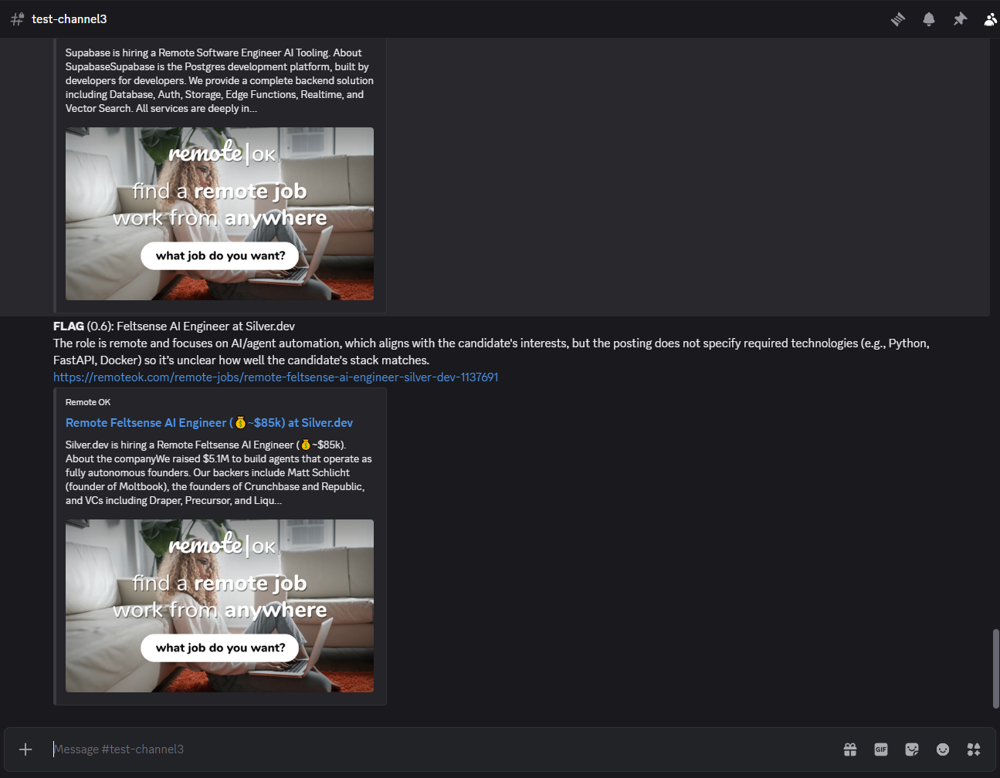

# Job Jingler

A Python agent that scrapes remote job listings, judges each one against my profile
with an LLM, saves the results, and sends the promising ones to Discord. For the
best matches it also drafts a cover note. It never contacts anyone by itself:
I read every note before using it.



## How it works

```
RemoteOK pages -> scraper (Playwright) -> skip jobs already seen
  -> LLM verdict: draft / flag / skip, with reasoning and a score
  -> SQLite -> Discord alert (+ cover note for drafts)
```

## Stack

Python, Playwright, Groq API (gpt-oss-120b), Pydantic, SQLAlchemy + SQLite, Discord webhooks.

## Setup

1. `pip install -r requirements.txt`
2. `playwright install chromium`
3. Copy `.env.example` to `.env` and fill in your Groq key and Discord webhook URL.
4. `python main.py`

## Design decisions

- **Pydantic models** (`Posting`, `Decision`) validate data between steps, so bad data fails early.
- **Human in the loop.** The agent drafts, I decide what gets sent.
- **Deduplication by URL**, so a job is judged and alerted once.
- **The scraper reads the JSON data embedded in each listing** instead of fragile CSS selectors.
- **Prompt tuned against 8 hand-labelled test postings** (`tools/mock_data.py`).
- **Failures are isolated.** One broken source or failed note doesn't stop the run.

## Limitations

- Verdicts on borderline postings can change between runs.
- RemoteOK tag pages include unrelated jobs, so most results are skips.
- Cover notes can bend facts and must be reviewed before use.
- One job source so far.
